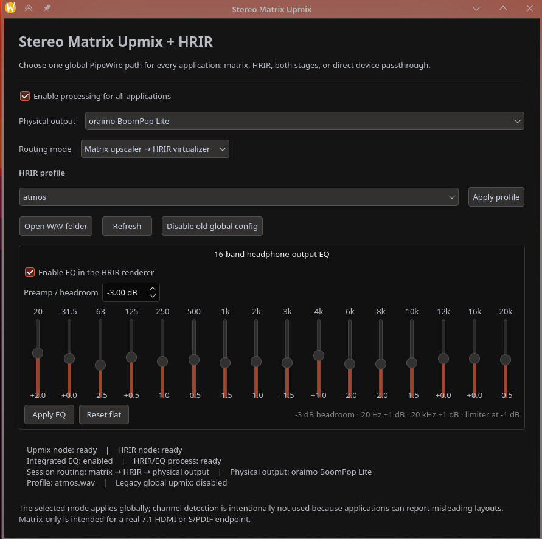

# Stereo Matrix Virtualizer

Stereo Matrix Virtualizer is a native PipeWire controller for matrix-upmixing
stereo to 7.1, rendering native or upmixed surround through an HRIR, and
applying an optional 16-band headphone-output EQ and limiter.

The physical speaker, headphone or HDMI device remains the system default.
The persistent router assigns application streams to the selected processing
path without presenting a virtual processor as hardware.

## Signal paths

- **Matrix + HRIR:** stereo application → PSD matrix upmix → 7.1 HRIR → headphones
- **Matrix only:** stereo application → PSD matrix upmix → physical 7.1 output
- **HRIR only:** multichannel application → 7.1 HRIR → headphones
- **Off:** application → selected physical output

Modes are selected manually. Automatic channel detection is intentionally
avoided because applications frequently advertise misleading layouts.

n## Screenshots



## Requirements

- Linux with PipeWire and WirePlumber
- `pw-loopback`, `pw-dump`, `pw-link`, `pw-cli`, `pw-metadata`, `wpctl` and `pactl`
- Python 3 and PySide6 QtWidgets
- SWH LADSPA plugins (`amp_1181` and `fast_lookahead_limiter_1913`)
- A compatible multichannel HRIR WAV file
- A systemd user session

On Debian-family distributions the packages are typically named `pipewire`,
`pipewire-bin`, `wireplumber`, `pulseaudio-utils`, `swh-plugins`,
`libpyside6-py3-6.11` (name varies by release), and `desktop-file-utils`.

## HRIR profiles

No impulse-response files are redistributed with this project. Put compatible
WAV files in:

```text
~/.local/share/stereo-matrix-virtualizer/hrir/
```

The manager also discovers an existing Virtual Surround Manager collection at:

```text
~/.var/app/de.berny23.virtual_surround_manager/data/virtual-surround-manager/hrir_wav/
```

Profiles must use the 14-channel layout expected by Virtual Surround Manager's
7.1 renderer. The file supplies left/right binaural impulses for the surround
positions; LFE reuses the center impulse pair.

## Install

```bash
./install.sh
```

To run dependency checks without installing anything:

```bash
./install.sh --check
```

Launch **Stereo Matrix Upmix** from the application menu, or run:

```bash
~/.local/bin/stereo-upmix-manager
```

The installer is per-user and does not require root. Processing services are
enabled only when the processing switch is turned on.

## Remove

```bash
./uninstall.sh
```

Uninstalling preserves user EQ settings, route state and HRIR files.

## Create a release archive

```bash
./make-release.sh
```

The release archive has normalized ownership, timestamps and ordering, so the
same source tree and version produce the same checksum.

## Implementation notes
- Developed and tested on Wayland.

- Matrix upmixing uses PipeWire's `channelmix.upmix-method = psd`.
- HRIR convolution and EQ run in a native PipeWire filter-chain.
- The router is the sole owner of live application routing.
- Mode changes use make-before-break link replacement.
- The GUI may close without changing the active routing state.
- No normal operation restarts PipeWire or WirePlumber.

## Naming and trademarks

This is an independent matrix-surround and binaural-rendering project. It is
not affiliated with, endorsed by, or an implementation licensed by Dolby
Laboratories or DTS, Inc. Dolby and DTS names that may appear in user-supplied
HRIR filenames remain the property of their respective owners.

## Bug Reporting

If you encounter any issues, please:
- Open a GitHub Issue in the [Issues tab](https://github.com/Kevinscki/stereo-matrix-virtualizer/issues).
- Or send a detailed report to [kelvinrutatina@gmail.com](mailto:kelvinrutatina@gmail.com).

Please include your system logs and the specific PipeWire version you are using.

## License

MIT. See [LICENSE](LICENSE).
