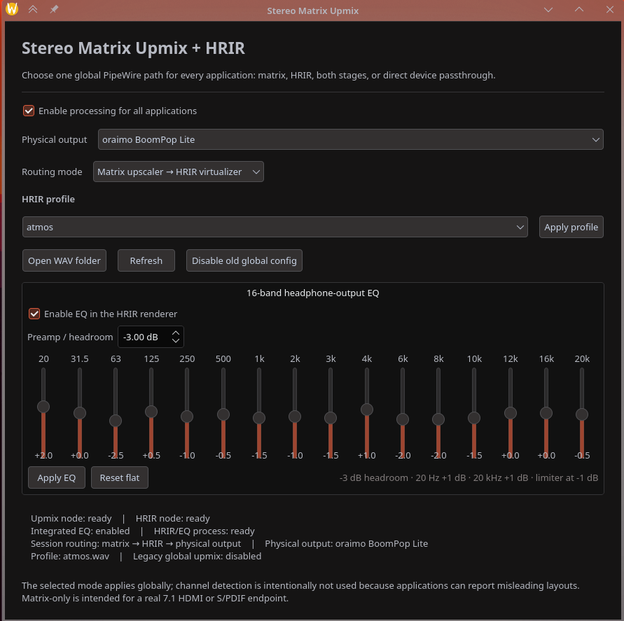

# Stereo Matrix Virtualizer

Stereo Matrix Virtualizer is a native PipeWire controller for upmixing stereo
to 7.1 (passive matrix, FreeSurround active decoding or the FFmpeg `surround`
filter), rendering native or upmixed surround through an HRIR, and applying an
optional 16-band headphone-output EQ and limiter.

The physical speaker, headphone or HDMI device remains the system default.
The persistent router assigns application streams to the selected processing
path without presenting a virtual processor as hardware.

## Signal paths

- **Passive + HRIR:** stereo application → PSD matrix upmix → 7.1 HRIR → headphones
- **Passive only:** stereo application → PSD matrix upmix → physical 7.1 output
- **Active + HRIR:** stereo application → FreeSurround decode → 7.1 HRIR → headphones
- **Active only:** stereo application → FreeSurround decode → physical 7.1 output
- **FFmpeg + HRIR:** stereo application → FFmpeg `surround` upmix → 7.1 HRIR → headphones
- **FFmpeg only:** stereo application → FFmpeg `surround` upmix → physical 7.1 output
- **HRIR only:** multichannel application → 7.1 HRIR → headphones
- **Off:** application → selected physical output

Modes are selected manually. Automatic channel detection is intentionally
avoided because applications frequently advertise misleading layouts.

## Screenshots



## Requirements

Required for every mode:

- Linux with a systemd user session
- PipeWire with WirePlumber and the PulseAudio compatibility server
  (`pipewire-pulse`). Developed and tested on PipeWire 1.6.
- PipeWire and PulseAudio tools: `pw-loopback`, `pw-dump`, `pw-link`, `pw-cli`,
  `pw-metadata`, `wpctl` and `pactl`
- Python 3.10 or newer with PySide6 (QtWidgets), available to `/usr/bin/python3`
- SWH LADSPA plugins (`amp_1181` and `fast_lookahead_limiter_1913`)
- A compatible multichannel HRIR WAV file (see [HRIR profiles](#hrir-profiles))

Optional:

- **FreeSurround active decoder:** `pw-record`, `pw-play`, a C and C++
  compiler, Git and network access while it is first built. If the pinned
  RetroSurround source cannot be fetched or compiled, installation continues
  with every other mode available.
- **FFmpeg surround engine:** `ffmpeg` 5.1 or newer (with the `surround` filter).

Run `./install.sh --check` to see what is present.

### Debian

**Debian 13 (trixie) and newer:**

```bash
sudo apt install pipewire pipewire-bin pipewire-pulse wireplumber \
    pulseaudio-utils swh-plugins python3-pyside6.qtwidgets desktop-file-utils
# Optional: FFmpeg engine, and building the FreeSurround decoder
sudo apt install ffmpeg build-essential git
```

**Debian 12 (bookworm):** Debian 12 does not package PySide6, so the manager
window cannot run with the system Python. The router, upmixers and HRIR
renderer have no PySide6 dependency, but they are configured through the
manager. Debian 12 also ships PipeWire 0.3.65, which is untested;
`bookworm-backports` provides PipeWire 1.4. Debian 13 or newer is recommended.

## FFmpeg surround settings

When an FFmpeg mode is selected, the manager shows a collapsible **FFmpeg
surround settings** panel with presets (Neutral, Matrix (PL2 / Neo), Movies,
Music (wide)), sliders for focus, angle, smoothness and centre/surround/LFE
levels, the LFE crossover, and the analysis window (quality versus latency).
Settings are stored in `~/.config/stereo-upmix-manager/ffmpeg-surround.json`.
Applying them reloads only the decoder pipeline; the input sink stays up, so
applications stay connected through a brief gap. The presets are starting
points to be tuned by ear.

For filter options the panel does not expose, put a complete option string in
`~/.config/stereo-upmix-manager/ffmpeg-surround.env`, for example
`STEREO_FFMPEG_SURROUND=win_size=4096:focus=0.2:smooth=0.3`, and restart
`stereo-ffmpeg-upmix.service`. This overrides the panel's settings entirely.

## HRIR profiles

No impulse-response files are redistributed with this project. Put compatible
WAV files in:

```text
~/.local/share/stereo-matrix-virtualizer/hrir/
```

Only this folder is used. To reuse an existing Virtual Surround Manager
collection, copy its WAV files here.

Profiles must use the 14-channel layout expected by Virtual Surround Manager's
7.1 renderer. The file supplies left/right binaural impulses for the surround
positions; LFE reuses the center impulse pair.

## Install

```bash
./install.sh
```

To run dependency checks without installing anything:

```bash
./install.sh --check
```

Launch **Stereo Matrix Virtualizer** from the application menu, or run:

```bash
~/.local/bin/stereo-upmix-manager
```

The installer is per-user and does not require root. Processing services are
enabled only when the processing switch is turned on.

## Remove

```bash
./uninstall.sh
```

Uninstalling preserves user EQ settings, route state and HRIR files.

## Create a release archive

```bash
./make-release.sh
```

The release archive has normalized ownership, timestamps and ordering, so the
same source tree and version produce the same checksum.

## Implementation notes

- Developed and tested on Wayland.
- Matrix upmixing uses PipeWire's `channelmix.upmix-method = psd`.
- Active decoding uses the FreeSurround DSP from RetroSurround in an isolated
  helper process with a 1024-sample analysis window.
- FFmpeg upmixing uses the `surround` filter in a separate `ffmpeg` process
  with its own PipeWire sink, so both active engines can be compared without
  restarting either.
- HRIR convolution and EQ run in a native PipeWire filter-chain.
- The router is the sole owner of live application routing.
- Mode changes use make-before-break link replacement.
- The GUI may close without changing the active routing state.
- No normal operation restarts PipeWire or WirePlumber.

## Naming and trademarks

This is an independent matrix-surround and binaural-rendering project. It is
not affiliated with, endorsed by, or an implementation licensed by Dolby
Laboratories or DTS, Inc. Dolby and DTS names that may appear in user-supplied
HRIR filenames remain the property of their respective owners.

## Active decoder licensing

The optional active decoder adapter is GPL-2.0-only and builds against
[RetroSurround](https://github.com/codanric/RetroSurround), pinned to commit
`4a25352be3b22d6a6e89a1b034a1698ecfff82c9`. RetroSurround incorporates the
GPLv2 FreeSurround decoder by Christian Kothe. This GPL component is a separate
program connected to the MIT-licensed controller through audio pipes and
PipeWire; it is not linked into the controller.

## References

Projects and documentation this work builds on or relates to:

- [RetroSurround](https://github.com/codanric/RetroSurround) (GPL-2.0): matrix
  surround decoder whose FreeSurround DSP the optional active decoder builds
  against, pinned to commit `4a25352`.
- [FreeSurround](https://github.com/rndusr/freesurround-fork) (GPL-2.0): the
  stereo-to-surround decoder by Christian Kothe; this is the fork credited by
  RetroSurround.
- [FFmpeg `surround` filter](https://ffmpeg.org/ffmpeg-filters.html#surround):
  the upmixer used by the FFmpeg engine.
- [PipeWire properties](https://docs.pipewire.org/page_man_pipewire-props_7.html):
  documents `channelmix.upmix-method = psd`, used by the passive matrix path.
- [Virtual Surround Manager](https://github.com/Berny23/virtual-surround-manager)
  (MIT): the HRIR renderer uses its 14-channel WAV layout and shares its
  settings format.
- [FreeSurround.lv2](https://github.com/And-Band/FreeSurround.lv2): a related
  LV2 plugin packaging of FreeSurround, not used by this project.

## Bug Reporting

If you encounter any issues, please:
- Open a GitHub Issue in the [Issues tab](https://github.com/Kevinscki/stereo-matrix-virtualizer/issues).
- Or send a detailed report to [kelvinrutatina@gmail.com](mailto:kelvinrutatina@gmail.com).

Please include your system logs and the specific PipeWire version you are using.

## License

MIT. See [LICENSE](LICENSE).
